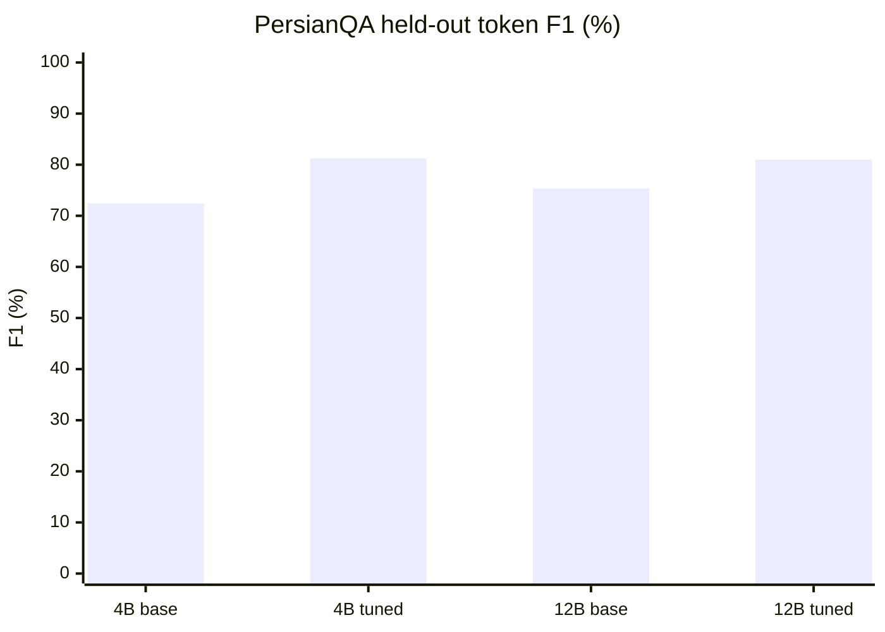

# Parameter-Efficient Fine-Tuning of Gemma 3 for Persian Question Answering

**Gemma 3 4B and 12B · 4-bit QLoRA · PersianQA ·**

## Abstract

We investigate parameter-efficient adaptation of **Gemma 3 4B Instruct** and **Gemma 3 12B Instruct** on Persian question answering dataset.Both models were fine-tuned with 4-bit quantization and Low-Rank Adaptation (LoRA), then evaluated against their on the same **930 held-out PersianQA examples**. Fine-tuning increased overall token F1 by **8.83 percentage points (4B)** and **5.63 points (12B)**. Gains were driven primarily by improved identification of unanswerable questions; answerable-question F1 decreased in both experiments.

## Method

The experiments use the [PersianQA dataset](https://huggingface.co/datasets/SajjadAyoubi/persian_qa).

| Configuration | Gemma 3 4B Instruct | Gemma 3 12B Instruct |
|---|---:|---:|
| Base checkpoint | `unsloth/gemma-3-4b-it-unsloth-bnb-4bit` | `unsloth/gemma-3-12b-it-bnb-4bit` |
| Quantization | 4-bit | 4-bit |
| LoRA rank / alpha | 16 / 32 | 8 / 16 |
| Trainable parameters | 32.79M | 32.74M |
| Learning rate | 1 × 10⁻⁴ | 1 × 10⁻⁴ |
| Optimizer steps | 250 | 250 |
| Effective batch size | 8 | 8 |
| Maximum context tokens | 560 | 288 |
| Held-out examples | 930 | 930 |

## Results

**All values are percentages.** Δ denotes the fine-tuned result minus its own untuned baseline, in percentage points (pp).

| Model | Metric | Untuned | Fine-tuned | Δ (pp) |
|---|---|---:|---:|---:|
| **Gemma 3 4B** | Token F1 | 72.41 | **81.24** | **+8.83** |
| | Exact Match | 53.44 | **62.15** | **+8.71** |
| | Answerable F1 | **80.10** | 77.04 | −3.06 |
| | No-answer F1 | 69.89 | **91.20** | **+21.32** |
| **Gemma 3 12B** | Token F1 | 75.34 | **80.97** | **+5.63** |
| | Exact Match | 60.43 | **63.87** | **+3.44** |
| | Answerable F1 | **80.44** | 76.66 | −3.79 |
| | No-answer F1 | 74.06 | **86.69** | **+12.63** |

### Overall token F1: baseline versus fine-tuned

### Paired bootstrap confidence intervals

| Model | Δ Token F1 (95% bootstrap CI, pp) | Δ Exact Match (95% bootstrap CI, pp) |
|---|---|---|
| Gemma 3 4B | **+8.83** [+6.36, +11.34] | **+8.71** [+5.37, +12.15] |
| Gemma 3 12B | **+5.63** [+3.38, +7.95] | **+3.44** [+0.22, +6.56] |

## Discussion

Both experiments show improved overall PersianQA scores after QLoRA fine-tuning. The improvement is **not uniform across question types**: both models became more effective at abstaining when the passage lacks an answer, while their F1 on answerable examples declined. Aggregate F1 improvements should therefore not be interpreted as uniformly better answer extraction.

**Evaluation limitations.** The 4B experiment recorded no context truncation. The memory-constrained 12B experiment truncated **820/930** contexts, and **45 answerable examples** lost all reference-answer spans in the retained context. The models also used different context budgets and LoRA ranks; the results **do not establish that one model size is superior** under a matched evaluation protocol. Each experiment used a single seed and 250 optimizer steps. 

