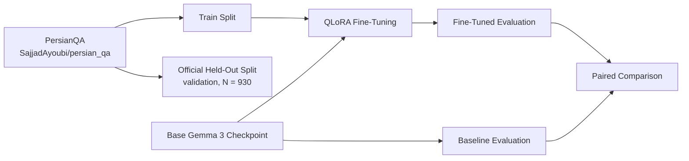
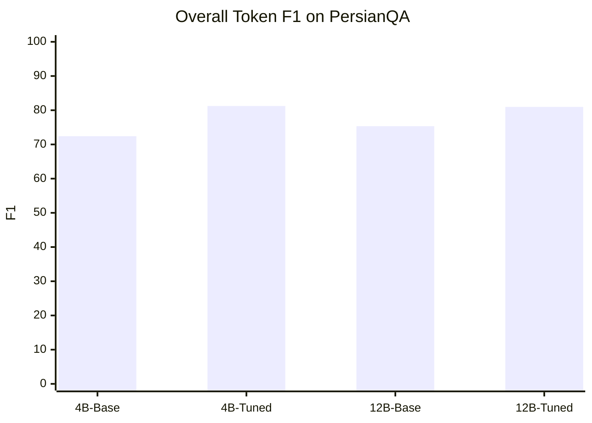
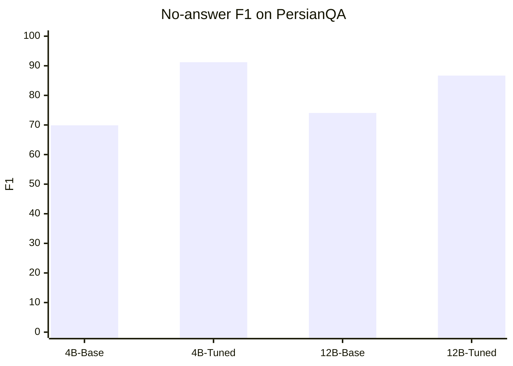

# Parameter-Efficient Adaptation of Gemma 3 for Persian Question Answering

## Abstract
This repository studies **parameter-efficient fine-tuning of Gemma 3 for Persian question answering** on **PersianQA**. Two controlled experiments were completed under low-resource hardware constraints using **4-bit quantization** and **LoRA**: **Gemma 3 4B Instruct** and **Gemma 3 12B Instruct**. In both settings, fine-tuning improved **overall token-level F1** and **Exact Match (EM)** on the official held-out split. The dominant effect was a strong improvement in **unanswerable-question detection**, accompanied by a measurable decline in **answerable-question F1**. The 12B experiment further demonstrates that a larger Gemma 3 checkpoint can be adapted on a **single NVIDIA T4 (16 GB)** using memory-constrained QLoRA.

---

## Research Question
Can low-rank adaptation of quantized Gemma 3 checkpoints improve Persian question answering under single-GPU constraints?

---

## Experimental Design



### Task
- **Dataset:** `SajjadAyoubi/persian_qa`
- **Evaluation split:** official held-out `validation` split, **N = 930**
- **Metrics:** Exact Match (EM), token-level F1, answerable-question F1, no-answer F1
- **Decoding:** greedy decoding

### Fine-Tuning Method
- **Method:** QLoRA / LoRA on 4-bit quantized checkpoints
- **Training objective:** answer-only supervision
- **Comparison protocol:** untuned checkpoint vs. fine-tuned checkpoint on the **same 930 examples**
- **Statistical reporting:** paired bootstrap confidence intervals

---

## Experimental Configurations

| Setting | Gemma 3 4B | Gemma 3 12B |
|---|---:|---:|
| Checkpoint | `unsloth/gemma-3-4b-it-unsloth-bnb-4bit` | `unsloth/gemma-3-12b-it-bnb-4bit` |
| Quantization | 4-bit | 4-bit |
| LoRA rank | 16 | 8 |
| LoRA alpha | 32 | 16 |
| Learning rate | 1e-4 | 1e-4 |
| Training steps | 250 | 250 |
| Gradient accumulation | 8 | 8 |
| Max context tokens | 560 | 288 |
| Max new tokens | 72 | 72 |
| Trainable parameters | 32,788,480 | 32,735,232 |
| Total parameters | 2,972,340,592 | 6,635,330,160 |
| Hardware | T4-compatible | T4-compatible |

---

## Main Results

### Controlled Baseline vs. Fine-Tuned Comparison

| Model | Condition | EM | Token F1 | Answerable F1 | No-answer F1 |
|---|---|---:|---:|---:|---:|
| Gemma 3 4B | Base | 53.44 | 72.41 | 80.10 | 69.89 |
| Gemma 3 4B | Fine-tuned | **62.15** | **81.24** | 77.04 | **91.20** |
| Gemma 3 12B | Base | 60.43 | 75.34 | 80.44 | 74.06 |
| Gemma 3 12B | Fine-tuned | **63.87** | **80.97** | 76.66 | **86.69** |

### Effect of Fine-Tuning

| Model | Δ EM (pp) | Δ Token F1 (pp) | Δ Answerable F1 (pp) | Δ No-answer F1 (pp) |
|---|---:|---:|---:|---:|
| Gemma 3 4B | +8.71 | +8.83 | -3.06 | +21.32 |
| Gemma 3 12B | +3.44 | +5.63 | -3.79 | +12.63 |

### Statistical Evidence

| Model | Paired 95% CI for Δ F1 (pp) | Paired 95% CI for Δ EM (pp) |
|---|---|---|
| Gemma 3 4B | [+6.36, +11.34] | [+5.37, +12.15] |
| Gemma 3 12B | [+3.38, +7.95] | [+0.22, +6.56] |

---

## Result Visualization

### Overall Token F1

| Model | Base | Fine-tuned |
|---|---:|---:|
| Gemma 3 4B | 72.41 | **81.24** |
| Gemma 3 12B | 75.34 | **80.97** |



### No-answer F1

| Model | Base | Fine-tuned |
|---|---:|---:|
| Gemma 3 4B | 69.89 | **91.20** |
| Gemma 3 12B | 74.06 | **86.69** |



---

## Interpretation
Fine-tuning improved **overall held-out performance** in both completed experiments. The improvement was not uniform. In both the 4B and 12B settings, the model became substantially better at **detecting unanswerable questions**, while **answerable-question F1 decreased**. The main empirical conclusion is therefore not merely that QLoRA improves PersianQA performance, but that it changes the model's operating behavior toward stronger abstention.

---

## Methodological Notes

### Gemma 3 4B
- Full held-out evaluation completed on 930 examples.
- No context truncation was recorded in the finalized 4B experiment.
- This is the cleanest completed experiment in the repository.

### Gemma 3 12B
- Full held-out evaluation completed on 930 examples.
- The 12B T4 configuration required a much smaller context budget.
- **820 / 930** examples were truncated.
- In **45 answerable examples**, truncation removed all gold answer spans from the visible context.
- The 12B results therefore demonstrate feasibility on T4, but they should not be interpreted as a clean scale comparison against the 4B experiment.

---

## Scope of Claims
This repository supports the following claims:
1. **Gemma 3 4B** can be effectively adapted for PersianQA with 4-bit QLoRA on consumer/Colab-class hardware.
2. **Gemma 3 12B** can be fine-tuned on a **single T4 GPU** under a constrained setup.
3. In both settings, fine-tuning improves **overall EM/F1** on the held-out split.
4. The primary gain is stronger **unanswerable-question detection**, not uniformly better answer extraction.

This repository does **not** support a claim that the 12B model is superior to the 4B model under a matched evaluation regime.

---

## Repository Contents

```text
.
├── Fine-Tuning-Gemma2/
│   └── Gemma2_(9B)_Alpaca.ipynb        # archival exploratory notebook
├── Gemma3_4B_PersianQA_*.ipynb         # completed 4B experiment
├── Gemma3_12B_PersianQA_*.ipynb        # completed 12B experiment
├── baseline.metrics.json
├── finetuned.metrics.json
├── comparison.json
├── report.md
├── README.md
└── LICENSE
```

---

## Archival Note on Gemma 2
The original repository was initiated around a **Gemma 2 9B** exploratory notebook. Those early experiments are retained for archival continuity, but the primary validated results in this repository are the completed **Gemma 3 4B** and **Gemma 3 12B** controlled experiments reported above.

---

## Citation-Style Summary
**Akhoundi-Andujerdi, Mohammad.** *Parameter-Efficient Adaptation of Gemma 3 for Persian Question Answering.* Controlled experiments on PersianQA using 4-bit QLoRA showed that fine-tuning improved overall token F1 from **72.41% to 81.24%** for Gemma 3 4B and from **75.34% to 80.97%** for Gemma 3 12B, with the strongest gains arising from improved no-answer detection.
